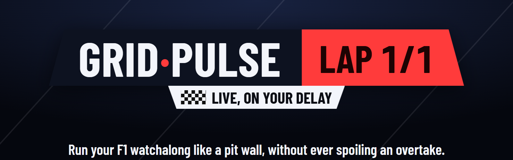
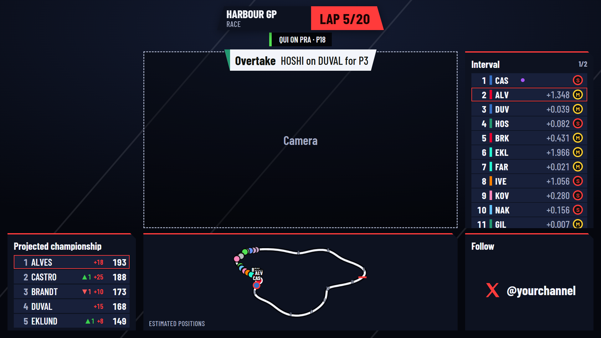
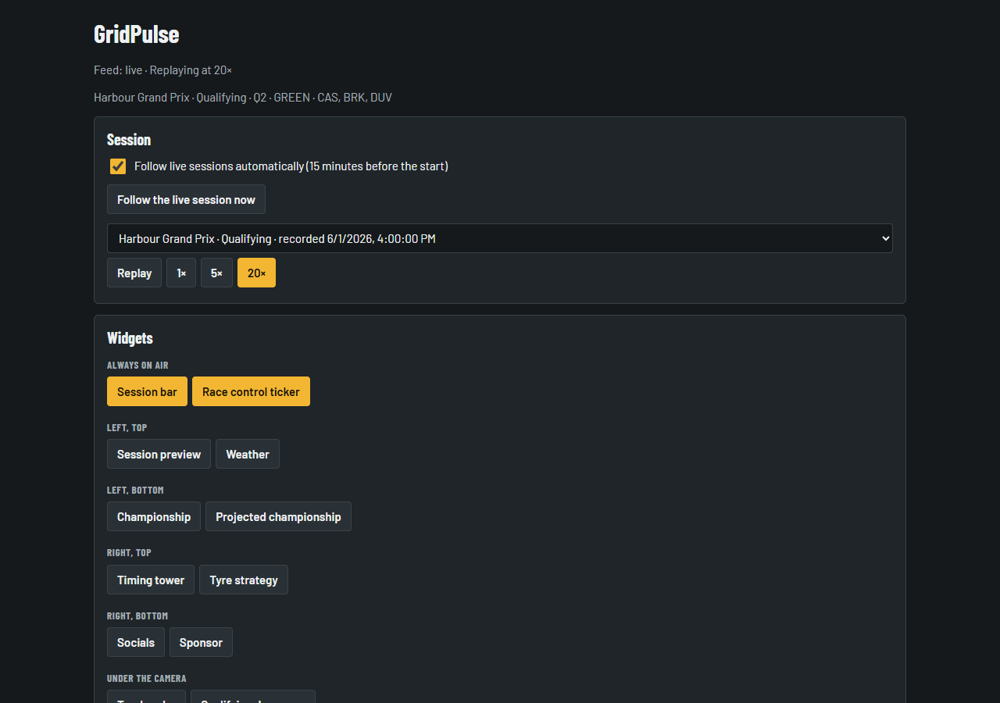
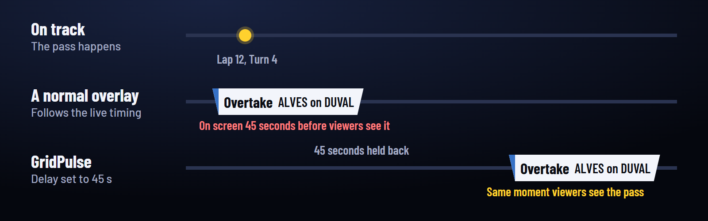
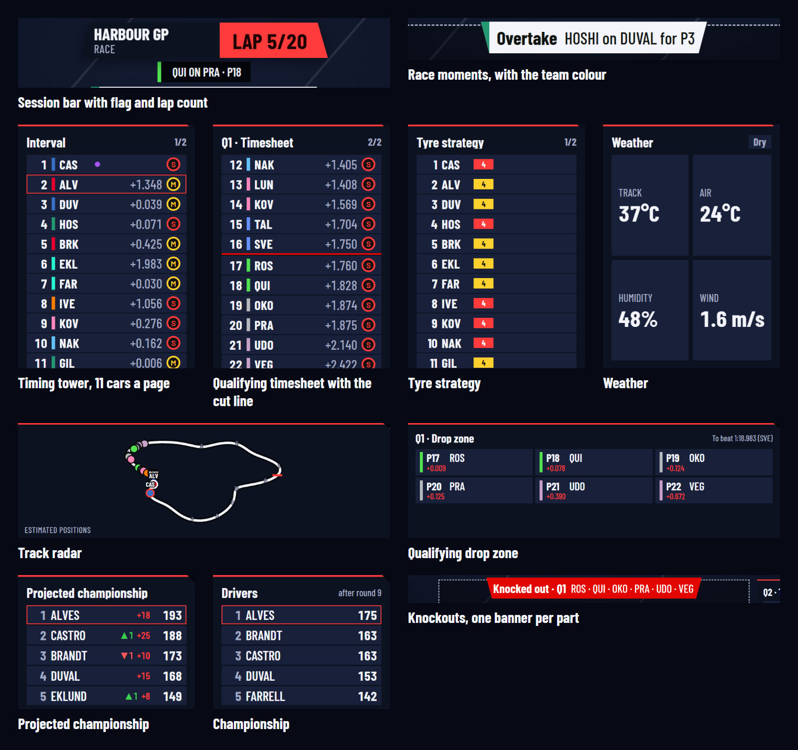
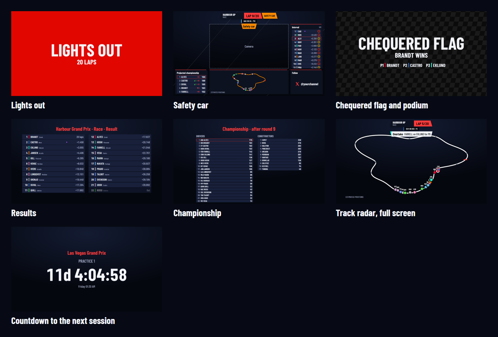
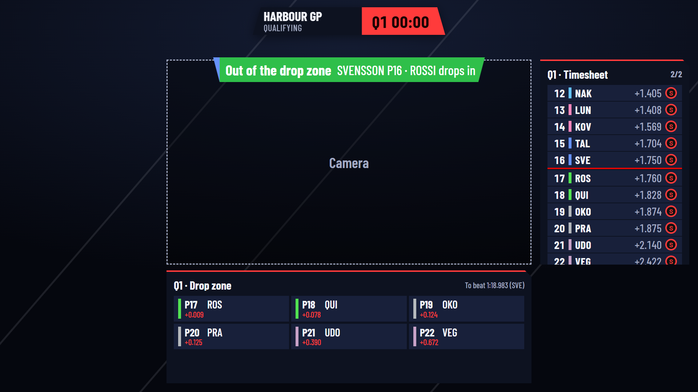

<p align="center">
  
</p>

<p align="center">
  <b>A self-hosted Formula 1 overlay for watchalong streamers.</b><br>
  Live timing tower, track radar, race moments, qualifying drop zone and standings on your stream, automatically, and held back until your viewers see the action.
</p>

<p align="center">
  <a href="#start-in-3-steps"><b>Start in 3 steps</b></a> &nbsp;·&nbsp;
  <a href="#never-spoil-an-overtake">Stream delay</a> &nbsp;·&nbsp;
  <a href="#everything-you-can-put-on-air">Widgets</a> &nbsp;·&nbsp;
  <a href="#questions">Questions</a>
</p>

<p align="center">
  
</p>

<p align="center"><sub>Captured from the built-in rehearsal race. The drivers, teams and circuit are fictional, and the dashed box is where your camera goes.</sub></p>

## From timing screen to pit wall

You commentate. GridPulse follows the session: it keeps the running order, gaps and tyres up to date and puts overtakes, pit stops, flags and the chequered flag on screen without anyone touching a button.

It runs on the free F1 live timing feed and free community data. There is no API key to buy and no account to create. An F1 TV subscription is an optional extra that switches the radar to exact car positions.

Built on [MatchRoom](https://github.com/Toxic-Joker/MatchRoom), the same overlay for football.

## Start in 3 steps

Rehearsals of a race, a qualifying session and a practice session are built in. They need no account or network, so you can see everything working in a couple of minutes.

### 1. Start it

You need [Node.js 20 or newer](https://nodejs.org).

```bash
git clone https://github.com/Toxic-Joker/GridPulse.git
```

```bash
cd GridPulse && npm install
```

```bash
npm start
```

Open the private link it prints. That's your control room, and the rehearsal race is ready to play.

For real sessions there's nothing to set up. GridPulse reads the season calendar and connects to the live feed 15 minutes before each practice, qualifying, sprint and race, even in the middle of a rehearsal. **Follow the live session now** connects at any time.

### 2. Light up your widgets

Each button puts a widget on air, and a lit button means it's showing. Each area of the screen holds one widget, so lighting a new one replaces its neighbour.



Further down the control room are the **Broadcast delay**, the optional **F1 TV** token and the link to **Add to OBS**.

### 3. Add it to OBS

Copy the overlay link from **Add to OBS** at the bottom of the control room and add it as a **Browser source** in OBS, or in any streaming app with browser sources. No plugin is needed.

| Order in the scene | Source | Size |
|---|---|---|
| Top | Overlay link with `&layer=front` added (widgets only) | 1920×1080 |
| Middle | Your camera | Centre of the screen, under the session bar |
| Bottom | Overlay link with `&layer=back` added (backdrop, optional) | 1920×1080 |

For TikTok or Shorts, use the **portrait** link from the same list (it ends in `&format=portrait`) in a 1080×1920 scene. The layers work the same way, with your camera at the top under the session bar. One control room drives both, so the same click lights the tower on both streams.

You're live.

## Never spoil an overtake

Your stream reaches viewers 30 to 60 seconds after the live timing does. An overlay on live data would show the pass, the pit stop or the safety car before they see it.



Set how far your stream is behind in **Broadcast delay** in the control room, from 0 to 300 seconds. Everything from the feed then waits until it's due: the tower, the radar, flags, moments and the projected championship. The buttons you press still work instantly.

## Everything you can put on air



### Race moments

Lights out, overtakes, a new leader, pit stops, the fastest lap, penalties, retirements, the safety car, VSC and red flag, the restart, a lap 1 summary and the chequered flag with the podium. Each one can be full screen, a banner, a line in the ticker, or off.

A position gained in the pits is not an overtake, and neither is a change under the safety car or after the flag. When a restart brings a burst of passes, one banner every 5 seconds goes on air and the rest go to the ticker, with the top 3 and the drivers you follow first.

### Full-screen moments



### Qualifying and practice



In qualifying the tower becomes a timesheet with a red line under the last safe place, and the **drop zone** widget shows who is out if the part ended now and the time to beat. Moments: a new part, provisional pole, a driver lapping out of the drop zone and who drops in, the knockouts of each part as one banner, and deleted laps. Sprint qualifying works the same way.

Practice gets a timesheet, the session clock, new fastest times and deleted laps.

### The track radar

The radar draws the real circuit with its corners, and colours the track yellow, orange or red with the flags.

- **Without F1 TV:** each car is placed from the timing data: its last timed section of track and its current pace. The order always matches the tower, and the radar says **Estimated positions** on screen.
- **With F1 TV:** paste your token in the control room and the radar shows exact car positions. The token stays on your computer and is never sent to the overlay.

On-air text comes in English, French, Spanish and Portuguese.

## Built for live use

- **It finds the session for you.** The calendar decides when to connect, and a session that has already finished is skipped.
- **It records every session.** Anything it follows live can be replayed later, at 1×, 5× or 20×, through exactly the same pipeline.
- **It keeps running.** Close the control room or reload an OBS source and nothing stops. Both catch up the moment they reconnect. If the feed drops, the last state stays on air while it reconnects.
- **It joins late cleanly.** Connecting on lap 40 doesn't replay 39 laps of moments.
- **It works from a Stream Deck.** Add a **Website** action with a link like `http://127.0.0.1:3000/deck/toggle/radar?token=YOUR_CONTROL_TOKEN` and tick "GET request in background". There are links to turn a widget on or off, hide everything and change the delay. They carry your control token, so keep them private.

## Questions

<details>
<summary><b>What does it cost?</b></summary>
<br>

Nothing. GridPulse is free for noncommercial use and runs on your own machine. Live timing comes from F1's free live feed, the calendar and standings from [Jolpica](https://github.com/jolpica/jolpica-f1), and circuit maps from MultiViewer's free API.

F1 TV is optional: it gives the radar exact car positions and lets you import past sessions from F1's archive. OpenF1 isn't used: it locks all its data, past sessions included, behind a paid key while a session is live.

For commercial use, see the [license](#license).
</details>

<details>
<summary><b>Can I rehearse with a real past race?</b></summary>
<br>

Yes, once GridPulse has recorded one: every session it follows live is saved and appears in the replay list. F1's own archive of past sessions has needed an F1 TV login since October 2026, so the built-in rehearsals are fictional races, which work offline from the first start.
</details>

<details>
<summary><b>Is this official? Could it stop working?</b></summary>
<br>

It's unofficial and not associated with Formula 1. The live timing feed is undocumented, and F1 has changed what it publishes before. If the feed changes, the rehearsals and recordings keep working while GridPulse is updated. Qualifying and practice were built from what the community knows of the feed and will be checked against a real session.
</details>

<details>
<summary><b>Does it show race footage or team radio?</b></summary>
<br>

No. It only shows data and graphics. It's up to you to check that your stream follows your platform's rules. GridPulse uses no F1 logos or fonts.
</details>

<details>
<summary><b>Can I control it from my phone?</b></summary>
<br>

Yes. The server only accepts connections from your own computer by default. Set `HOST=0.0.0.0` in `.env` to allow other devices on your network. Traffic isn't encrypted, so only do this on a network you trust.
</details>

<details>
<summary><b>Can I run it with Docker?</b></summary>
<br>

Yes. Your settings, tokens and recordings are kept in a Docker volume, and the last command shows your control room link.

```bash
cp .env.example .env
```

```bash
docker compose up -d --build
```

```bash
docker compose logs gridpulse
```
</details>

<details>
<summary><b>How do I change it or contribute?</b></summary>
<br>

Run the tests with `npm test` and start a development server with `npm run dev`. [docs/ARCHITECTURE-ESSENTIALS.md](docs/ARCHITECTURE-ESSENTIALS.md) is the one-page map, [docs/ARCHITECTURE.md](docs/ARCHITECTURE.md) has the detail, and [docs/PRD.md](docs/PRD.md) says what it's for. `node scripts/readme-media.js` regenerates the images in this README from the real overlay.
</details>

## License

[PolyForm Noncommercial 1.0.0](./LICENSE): free for any noncommercial purpose. Commercial use needs a separate agreement with the copyright holder. Barlow fonts are under the SIL Open Font License, in `public/vendor/fonts`.
