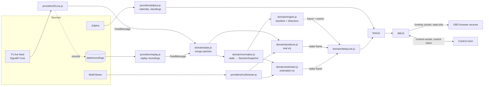

# GridPulse: architecture

Status: draft for v1 · 2026-11-08 · Product: [PRD.md](PRD.md) · Research: [PLAN.md](PLAN.md)

GridPulse is MatchRoom's architecture with a new domain layer. The server owns the show; browsers are views. Feed data flows one way through pure functions and a delay line, then out to read-only overlay sockets.

## Reuse vs build

| Part | Decision | Source |
|---|---|---|
| Server shell, sockets, tokens, show/widget system, delay line, control room, overlay shell, `dom.js`, i18n, fonts | **Copy** from MatchRoom (our own code, PolyForm NC) | [Toxic-Joker/MatchRoom](https://github.com/Toxic-Joker/MatchRoom) |
| Live feed connection | **Library**: `@microsoft/signalr` (MIT, Microsoft, v10). F1 moved to SignalR Core; FastF1, undercut-f1 and f1-dash all use `/signalrcore` | npm |
| `.z` topic decoding | **Node built-in** `zlib.inflateRawSync` | — |
| Feed topics, payload shapes, archive file layout, position-to-outline alignment | **Reimplement** from reading community clients. No code copied | termf1 (no licence), undercut-f1 (GPL-3), f1-dash (AGPL-3), FastF1 (MIT) |
| Calendar, standings, results | **Free API**: Jolpica | `api.jolpi.ca/ergast/f1` |
| Circuit outlines and corners | **Free API**: MultiViewer, cached forever | `api.multiviewer.app/api/v1/circuits/{key}/{year}` |
| Estimated radar, race detectors, projected championship | **Build**. Nothing reusable exists in JS with a compatible licence | — |

No existing JS/TS repo covers an F1 OBS overlay (`gh search repos "f1 overlay obs"` returned nothing). The only small MIT JS SignalR client found (steffjenl/nl.monkeysoft.f1, a Homey app) would need `repo-vetting` before we borrow anything; the official library makes that unnecessary.

## Stack

| Choice | Reason |
|---|---|
| Node 20+, CommonJS server, ES modules in the browser | Same as MatchRoom; no build step |
| Express 5 + socket.io 4 | Same as MatchRoom; tokens and origin checks already written |
| `@microsoft/signalr` | Official SignalR Core client, works in Node |
| `dotenv` | Same as MatchRoom |
| Plain SVG + CSS for overlays, no framework | Same as MatchRoom; OBS browser sources stay light |
| `node --test` | Same as MatchRoom; no test framework dependency |
| JSON files under `data/` for persistence | One user, one machine; no database needed |

## System overview



### Pipeline in words

1. A **provider** produces `FeedMessage`s: `{ topic, data, at }`. Live: from SignalR. Replay: from GridPulse's own recordings. `feed.js` stamps `at` with the wall clock on arrival. Both emit the same raw F1 payloads, so rehearsal runs the real pipeline (MatchRoom's simulator rule).
2. **`state.js`** keeps one `TimingState`: the full, merged F1 state. The feed sends partial patches (objects keyed by index or driver number, `_deleted` lists), and `.z` topics are base64 + raw deflate. Pure merge function plus a small class holding the result.
3. **`normalize.js`** turns `TimingState` into a `SessionSnapshot` (pure). Runs at most 4 times a second (throttled in `feed.js`), not on every patch.
4. **`engine.js`** compares snapshots: first snapshot is a baseline, then detectors produce `RaceEvent`s. Detectors are per session type (`detectors/race.js` in v1; qualifying and practice in v1.1).
5. **Radar frames** come from `positions.js` (real `Position.z`, replay or F1 TV live) or `estimator.js` (from the snapshot and the circuit outline), 4 a second.
6. Everything goes through **`delayLine.js`** (unchanged from MatchRoom) and out via `feed.js` → `app.js` → sockets.
7. **Tables** (calendar, standings) come from Jolpica on a timer, only when a widget on air needs them.

## Data models

Defined as JSDoc types in `server/domain/types.js`. Snapshots are plain JSON so they cross the socket unchanged.

**FeedMessage** `{ topic: string, data: object, at: number }` — `topic` without `.z` after decoding (`Position`, `CarData`).

**TimingState** — raw merged F1 topics: `{ SessionInfo, SessionStatus, TrackStatus, LapCount, ExtrapolatedClock, DriverList, TimingData, TimingAppData, TimingStats, RaceControlMessages, WeatherData, Position, CarData }`. Only `state.js` and `normalize.js` know this shape.

**SessionSnapshot**
```
session:   { key, year, meetingName, circuitKey, circuitName, country, type, name, path }
           type: 'race' | 'sprint' | 'qualifying' | 'sprint_qualifying' | 'practice'
status:    'pre' | 'running' | 'suspended' | 'finished' | 'ended'
track:     { status: 'green' | 'yellow' | 'sc' | 'vsc' | 'vsc_ending' | 'red', since }
laps:      { current, total }                    // race/sprint
clock:     { remainingMs, running, rate }        // extrapolated session clock
drivers:   DriverRow[]                           // sorted by position
fastestLap:{ number, time, lap } | null
raceControl: RCMessage[]                         // newest last, capped at 50
weather:   { airTemp, trackTemp, humidity, rainfall, windSpeed } | null
```

**DriverRow**
```
number, code, name, team, teamColour,
position, gridPosition, gapToLeader, interval,     // strings as shown ("+1.234", "1 L", "LAP 12")
lastLap, bestLap, laps, pitStops,
inPit, pitOut, retired, stopped, knockedOut,
tyre:     { compound: 'SOFT'|'MEDIUM'|'HARD'|'INTERMEDIATE'|'WET'|'UNKNOWN', age, isNew },
progress: { sector, segment, segmentsPerLap, at }  // last completed mini-sector, for the estimator
```

**RaceEvent** `{ type, key, at, ...fields }`. Types in v1: `lights_out`, `overtake {by, on, forPosition}`, `new_leader`, `pit {number, stop}`, `fastest_lap`, `track_status {status, from}`, `penalty {number, text}`, `retirement`, `lap1_summary {gains[], losses[]}`, `chequered`, `session_status`. `key` is unique per real-world moment so a repeat is never announced twice.

**RadarFrame** `{ mode: 'live'|'estimated'|'replay', at, cars: [{ number, x, y, inPit, retired }] }` with `x, y` in the circuit's own coordinates; the overlay maps them to the SVG with the circuit's bounds and rotation.

**Circuit** `{ key, year, rotation, outline: [[x,y]...], corners: [{ number, x, y }], bounds: { minX, maxX, minY, maxY }, lengthM }` plus a precomputed cumulative distance along the outline (used by the estimator).

**Calendar** `{ season, rounds: [{ round, name, circuitId, country, sessions: [{ type, startsAt }] }] }` — Jolpica's `FirstPractice`, `Sprint`, `Qualifying`, etc. mapped to our session types.

**Standings** `{ season, round, drivers: [{ code, name, team, points, position }], constructors: [{ team, points, position }] }`.

**Show** — MatchRoom's shape: `{ widgets, delaySeconds, themeId, themeAuto, custom, lang, background, cameraGuide, auto, socials, sponsor, countdown, followedDrivers, replay: { sessionPath, speed } }`. `auto` holds the full screen/banner/off setting per event type.

**Secrets** (`data/secrets.json`, never in `Show`): `{ f1tvToken, f1tvTokenExpiresAt }`.

## Interfaces

**Provider** (live and replay implement the same shape):
```
start(onMessage(FeedMessage)) → Promise<void>
stop()
status → { state: 'idle'|'connecting'|'live'|'stale'|'finished'|'error', message }
```
Replay adds `list()`, `select(recordingId)`, `setSpeed(n)`. A topic of `"*"` carries a full state and makes the engine re-baseline.

**Tables providers**: `jolpica.calendar(season)`, `jolpica.standings(season)`, `jolpica.results(season, round)`; `multiviewer.circuit(key, year)`. All go through `providers/cache.js` (file cache with TTL in `data/cache/`).

**Sockets** (unchanged from MatchRoom, new payloads):
- `/overlay` (read-only token) receives `hello {show, frame, radar, tables}`, then `frame`, `radar`, `event`, `tables`, `show`, `reset`.
- `/control` (control token) sends `action {name, ...}` and receives the same plus `status` and `log`. New actions: `follow {source:'live'|'replay', path}`, `replaySpeed`, `f1tvToken {token}` (write-only: the server answers with presence and expiry, never the token).

## Folder structure

```
server/
  index.js            start-up, env, tokens
  app.js              express, sockets, auth, CSP
  feed.js             runs one session: provider → state → snapshot → engine → delay line
  show.js             widgets, themes, actions (from MatchRoom)
  secrets.js          F1 TV token storage and redaction
  domain/             pure, no I/O
    types.js          JSDoc data models
    state.js          merge F1 patches, decode .z
    normalize.js      TimingState → SessionSnapshot
    engine.js         baseline + dispatch to detectors
    detectors/race.js race/sprint moments
    points.js         points tables, projected championship
    estimator.js      estimated car positions
    positions.js      real positions → RadarFrame
    track.js          outline geometry: distance along track, nearest point
    delayLine.js      from MatchRoom
  providers/          I/O only
    f1Live.js         SignalR Core client
    recordings.js     recording format: write, list, read
    replay.js         replays a recording as FeedMessages
    archive.js        F1 archive paths (import needs F1 TV, v1.1)
    jolpica.js        calendar, standings, results
    multiviewer.js    circuits
    cache.js          file cache with TTL
public/
  control/            control room
  overlay/            OBS page: overlay.js, widgets.js, trackRadar.js, dom.js, i18n.js
  shared/             fonts, theme tokens
test/
  fixtures/           hand-written synthetic feed snippets (no F1 data committed)
  domain/*.test.js
  server/*.test.js
data/                 git-ignored: show.json, tokens.json, secrets.json, cache/, recordings/
docs/
```

## Key flows

**Recording.** `f1Live` writes every connection to `data/recordings/<started>_<sessionKey>.jsonl` (`providers/recordings.js`): first line `{"kind":"state","at","data"}` (the Subscribe reply), then `{"kind":"msg","at","topic","data","utc"}` per feed message, and a new state line after each reconnect.

**Rehearsal.** Control room → `GET /api/recordings` (session read from each file's first line) → `follow {source:'replay', recording}` → `replay.js` reads the file and emits the lines as FeedMessages with their original spacing ÷ speed (gaps capped at 10 s) → normal pipeline. A half-written last line is skipped. Recording ids must match `^[A-Za-z0-9_-]{1,80}\.jsonl$` and exist in the list before they are opened.

**Rehearsal race.** `providers/rehearsal.js` simulates a fictional 20-lap race (deterministic seed, 0.25 s steps) and writes it as `data/recordings/rehearsal-harbour-gp-v<VERSION>.jsonl` on start if missing. It emits the feed's own payloads (timing points with in-step crossing times, sectors, laps, positions, pit stops, stints, track status, race control, clock, weather) plus `{"kind":"truth","at","cars":{number:{d,laps,inPit,retired,finished}}}` once a second. Replay skips any kind other than `state` and `msg`. Bump `VERSION` whenever the output changes, so existing installs get the new file.

**F1 archive (F1 TV only).** Since about 15 October 2026 every archive file answers 401 without an F1 TV login. `archive.js` keeps path validation and URL building; importing a past session with the token and converting it into the recording format is v1.1. Paths must match `^\d{4}/\d{4}-\d{2}-\d{2}_[^/]+/\d{4}-\d{2}-\d{2}_[^/]+/$` and are URL-encoded per segment.

**Live.** `feed.js` checks the calendar every minute; within 15 minutes of a session it starts `f1Live` ("Connect now" starts it at any time). It stays connected until `SessionStatus` is `Finalised` or `Ends`, or 5 hours after the scheduled start. On connect, the `Subscribe` reply carries the full current state, which becomes the baseline; every reconnect re-baselines. Radar mode is `live` if a valid F1 TV token is set and `Position` messages arrive, otherwise `estimated`. If no `Position` message arrives for 10 s in live mode, the radar falls back to `estimated` and the control room says why.

**Throttles use the wall clock.** Snapshots (4 Hz) and radar frames (4 Hz) are paced by real time, not the replay clock, so a 20× replay sends the same number of frames to OBS as a live session. Positions between samples are interpolated on the overlay.

**Session types in v1.** `normalize.js` handles every session type, so practice and qualifying show the session bug and a tower in the feed's order. Only `detectors/race.js` exists in v1; for other types the engine emits `track_status` and `session_status` only.

## Race detector rules

All rules run on consecutive snapshots after the baseline.

- **Overtake** `A passes B` only when: status `running`; track `green` or `yellow`; lap ≥ 2; neither car in pit, pit-out, retired or stopped in this or the previous snapshot; both on the same lap; and the new order holds in 2 consecutive snapshots (≈0.5 s debounce). Never after `chequered`.
- **Lap 1:** overtakes are collected, not announced; when the leader starts lap 2, emit `lap1_summary` with gains and losses against `gridPosition` (pit-lane starters count from the back).
- **New leader:** position 1 changes under the overtake rules, or via the pit cycle (announced as `new_leader`, not an overtake).
- **Pit:** `pitStops` increases or `inPit` turns true then false.
- **Restart:** status goes from `suspended` to `running` → `restart` event; a standing restart also emits `lights_out`.
- **Rate limit:** one overtake banner per 5 s; the rest go to the ticker. Priority: followed drivers, then the top 3, then the rest.
- **Points:** race P1–P10 `25,18,15,12,10,8,6,4,2,1`; sprint P1–P8 `8,7,6,5,4,3,2,1`; no fastest-lap point. Projection base = Jolpica standings before this round + this weekend's sprint result if Jolpica's standings don't include it yet (checked by comparing the round and the sprint results endpoint).
- Grid size is never hard-coded: 2026 has 22 cars.

**Meeting ↔ round matching.** The feed identifies a meeting by `Meeting.Key` and circuit key; Jolpica by season + round. We match them by race date (±3 days) and country. MultiViewer uses the same circuit key as the feed.

## Spike results (2026-11-08)

- **Spike 1, live feed:** anonymous connection from Node works. The Subscribe reply contains every free topic. `Position.z`, `CarData.z` and `ChampionshipPrediction` are absent without F1 TV; `PitLaneTimeCollection` arrives but was empty. During a race, `TimingData` sends about 8 patches a second.
- **Spike 2, archive:** every file, any season, answers 401 since about 15 October 2026. FastF1 and undercut-f1 added F1 TV login for it.
- **Real payload notes** (from the São Paulo GP recording): 22 cars; 22 mini-sectors per lap there (7 + 8 + 7); segment status 2048 = completed, 0 = not yet; `TrackStatus` codes 1/2/4/5/6/7; `SessionStatus` goes `Started` → `Finished` at the flag; `ExtrapolatedClock` keeps `Extrapolating: true` after the flag; `RaceControlMessages` patches add index keys; race control `Utc` has no time zone (it is UTC).

## Estimated radar

From the snapshot: each car's last completed mini-sector (TimingData `Sectors[].Segments[]`), when it completed it, and its recent lap time. Position along the lap = distance of that mini-sector's end + (time since) × (lap length ÷ recent lap time), capped at the next mini-sector's end, so a car never runs ahead of what timing has confirmed. Mini-sector boundaries start evenly spaced along the outline. Learning real boundaries from archive positions is only built if spike 4 shows even spacing misses the accuracy target. Order is then forced to match the tower: a car is never drawn ahead of a car above it on the same lap. Pit lane cars are drawn in a separate pit strip.

## Security

- Copied from MatchRoom: localhost bind by default; separate read-only overlay token and control token; sockets reject foreign origins; CSP; feed text only ever becomes text nodes; image URLs must be `https:` or `data:image/`.
- F1 TV token: stored in `data/secrets.json` (file mode 600 where the OS supports it), sent only to the F1 feed as a cookie, never included in any socket message, `show.json`, or log line. The control room only sees `{ present, expiresAt }`. `.gitignore` covers `data/` and `.env`.
- Downloads: only from `livetiming.formula1.com/static/`, `api.jolpi.ca`, `api.multiviewer.app`; paths validated against a pattern before building a URL; parsed as JSON only, never executed.
- Every outgoing request has a timeout (10 s) and a size cap (archive files 50 MB).
- Rate limits: Jolpica calendar cached 24 h, standings and results 1 h, and requests serialised (Jolpica allows a few per second and a few hundred per hour). MultiViewer circuits cached forever.
- Delay line memory: at 300 s delay and 8 frames/s, about 2,400 queued frames of a few kB each. Acceptable; `DelayLine` keeps no more than 5,000 items and drops the oldest frames (never events) past that.

## Errors and logging

- Feed problems keep the last state on air (MatchRoom rule: a stale screen beats an empty one). Status `stale` shows in the control room.
- Live reconnect: exponential backoff 2 s → 60 s, reset after 5 minutes connected. A reconnect re-baselines the engine so nothing old is announced.
- Unknown topics and unexpected fields are ignored, not fatal. A malformed message is logged once per topic per session and skipped.
- Logs are human lines to stdout and the control room log (as MatchRoom), with the token redacted.

## Testing

- **Domain (most tests):** pure functions with synthetic fixtures — patch merging, `.z` decoding, normalize, each race detector (including pit-stop-is-not-an-overtake, lap 1 suppression, baseline on join), points, estimator ordering, delay line (carried over).
- **Server:** sockets, tokens, actions (carried over), plus "token never leaves the server".
- **End to end:** a short synthetic recording (written by us in the recording format) runs through the whole pipeline and asserts the event list.
- **Spikes** produce real recordings in `data/` for manual checks; real F1 data is never committed.

## Running

```
npm install
npm start          # prints the control room link
npm test
```
Docker and `docker-compose.yml` as in MatchRoom. Environment variables in `.env.example`.

## Decisions log

| # | Decision | Alternatives considered | Why |
|---|---|---|---|
| D1 | New repo seeded from a copy of MatchRoom | GitHub fork; shared core package | Domain layer is almost all new; a shared package is premature with two consumers |
| D2 | F1 live feed as primary data; F1 archive only with F1 TV (see D12) | OpenF1 | OpenF1 locks all access during live sessions without a paid key |
| D3 | `@microsoft/signalr` | Hand-written client on `ws`; classic `/signalr` endpoint | Community clients moved to SignalR Core; official MIT library. Confirmed by spike 1 |
| D4 | ~~Replay of a real archived session as rehearsal~~ Superseded by D12 | Scripted fictional race like MatchRoom | Real data exercises the real pipeline and radar; offline tests use a small synthetic replay instead |
| D5 | Estimated radar as default, F1 TV live as upgrade | Live-only radar; no radar without F1 TV | Free-first; honest label on air |
| D6 | Snapshot throttled to 4 Hz | Normalize on every patch | The feed can send dozens of patches a second; overlays don't need more |
| D7 | Jolpica for calendar and standings | Feed's ChampionshipPrediction | That topic is F1 TV-gated; Jolpica is free and enough with our own projection |
| D8 | MultiViewer outlines, fallback to outline from archive positions | Hand-drawn SVGs | Real geometry, corners included, free |
| D9 | No copied code from termf1, undercut-f1, f1-dash | Copy their clients | No licence / GPL / AGPL are incompatible with PolyForm NC |
| D10 | ~~Replay session list merged from archive index, calendar-derived paths and recorded live paths | Archive index only | Superseded by D12: the whole archive needs F1 TV |
| D11 | Even mini-sector spacing for the estimator first | Learn boundaries from archive positions up front | Cut from v1 unless spike 4 shows it is needed |
| D12 | Free rehearsals replay GridPulse's own recordings of live sessions; F1 TV users can import archive sessions into the same format later | Archive replay for everyone; OpenF1 history | Spike 2 (2026-11-08): every archive file answers 401 without an F1 TV login since ~15 Oct 2026. OpenF1 locks during live sessions. Recording is free and uses the real pipeline |
| D14 | A generated fictional race is the default rehearsal, stored as a recording with true positions | Recordings only; a scripted provider like MatchRoom's simulator | Works offline on first run without F1 TV; reuses the replay path; its truth lines test the tower now and the estimated radar later |
| D13 | Anonymous SignalR Core connection to `/signalrcore` with `@microsoft/signalr` | Classic `/signalr` | Spike 1 (2026-11-08) connected anonymously and received every free topic |
